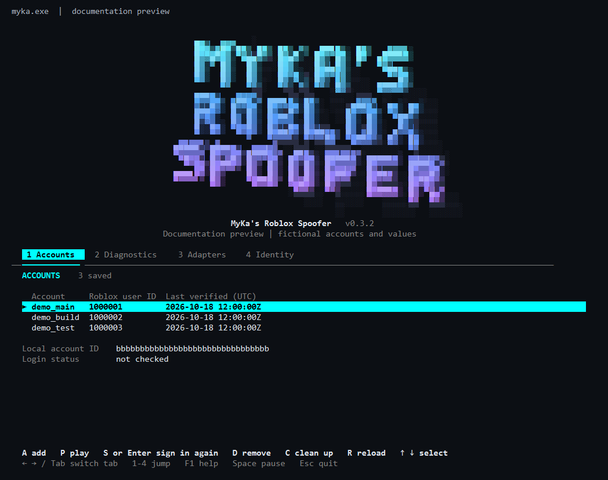
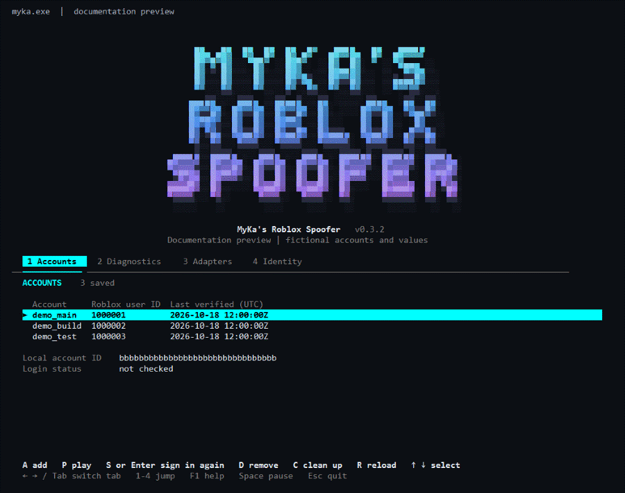
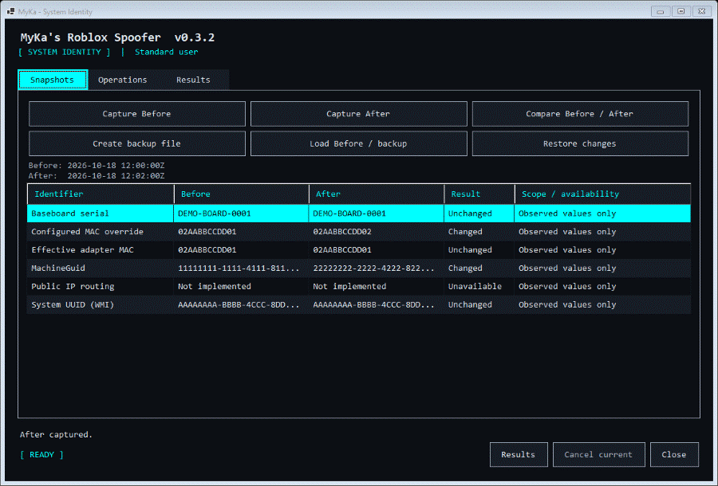
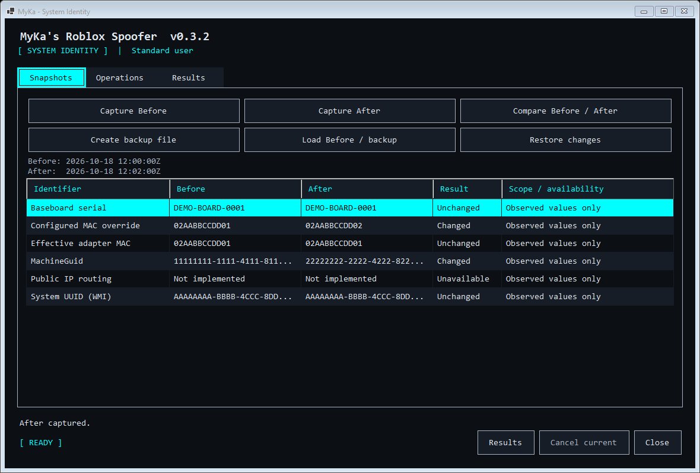
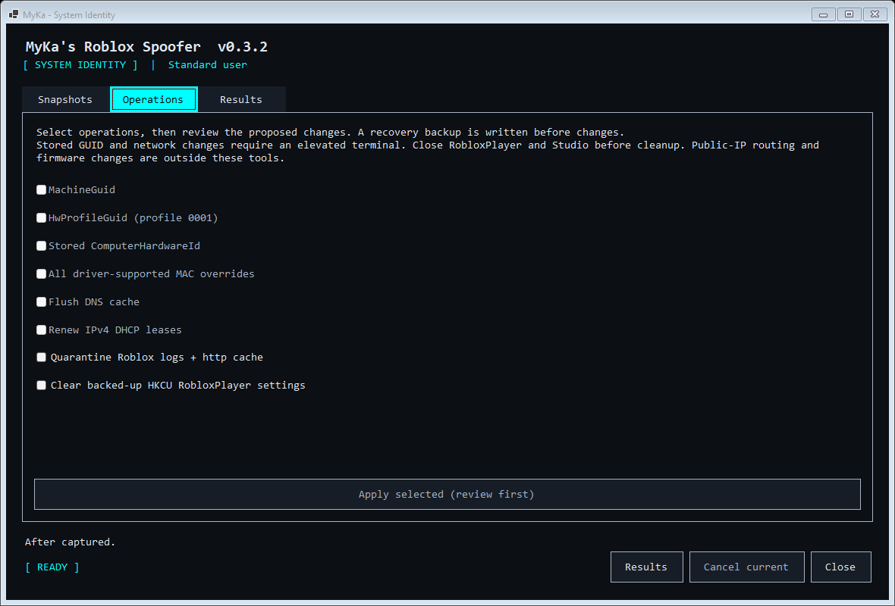
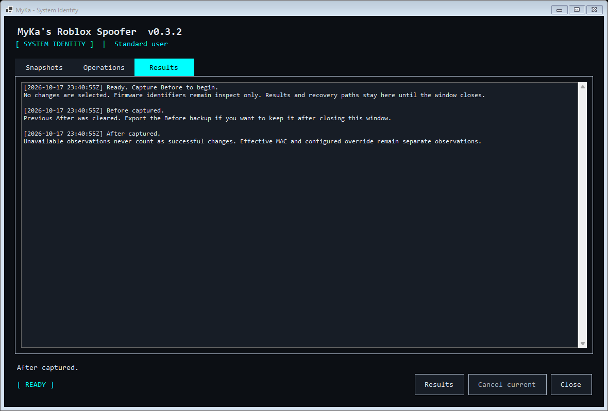

<div align="center">

# MyKa's Roblox Spoofer

A Windows terminal for Roblox accounts, diagnostics and reviewed system identity tools.

[](CHANGELOG.md)


[](LICENSE)

[Get started](#get-started) · [User guide](docs/user-guide.md) · [Architecture](docs/architecture.md) · [Contributing](CONTRIBUTING.md)

</div>



[English](README.md) | [العربية](docs/readme/README.ar.md) | [Português (Brasil)](docs/readme/README.pt-BR.md) | [简体中文](docs/readme/README.zh-CN.md) | [繁體中文](docs/readme/README.zh-TW.md) | [日本語](docs/readme/README.ja.md) | [한국어](docs/readme/README.ko.md) | [Türkçe](docs/readme/README.tr.md) | [Русский](docs/readme/README.ru.md) | [Tiếng Việt](docs/readme/README.vi.md) | [ไทย](docs/readme/README.th.md) | [Deutsch](docs/readme/README.de.md) | [Español](docs/readme/README.es.md) | [Українська](docs/readme/README.uk.md) | [Polski](docs/readme/README.pl.md) | [বাংলা](docs/readme/README.bn.md)

## What it does

Manage saved Roblox browser accounts, inspect the current Windows environment, and compare system identity snapshots before and after reviewed maintenance operations. The terminal and native System Identity window share a dark, monospaced design with cyan selection.

| Area | Available in 0.3.2 |
| --- | --- |
| Accounts | Separate WebView2 profiles, account verification, sign-in again, local removal and cleanup |
| Experiences | Recheck the saved browser account and request one desktop handoff from the experience page |
| Diagnostics | Runtime, WebView2, installation candidates, CPU, RAM, virtualization and display-adapter observations |
| System identity | Before/After snapshots, comparison, private JSON export and reviewed recovery files |
| Windows maintenance | Existing stored GUID replacement, driver-supported MAC overrides, DHCP renewal and DNS flush |
| Scoped cleanup | Quarantine Roblox `logs` and `http` folders; back up and clear the selected Player preference tree |
| Interface | Four keyboard tabs, scrollable help, responsive layouts, a ray-cast 3D wordmark and plain output |

Firmware UUID/serial spoofing, disk or volume rewriting, EDID rewriting, concurrent execution environments and public-IP routing are not implemented. Separate browser profiles do not isolate RobloxPlayer. A changed stored value does not prove a different device or unrelated accounts. Desktop launch and the account that joins remain unverified. Read the [exact identity scope](docs/system-identity.md#scope).

## See it in use

All screenshots and GIFs come from the application's terminal renderer or native controls using fictional accounts and synthetic snapshots. They demonstrate the interface, not real identifier changes or a verified Roblox session.

<details>
<summary>Watch the terminal and System Identity workflow</summary>

### Terminal wordmark



### Capture, compare and review



</details>

| Snapshots | Operations | Results |
| --- | --- | --- |
|  |  |  |

## Get started

You need Windows x64 and the [.NET 10 SDK](https://dotnet.microsoft.com/download/dotnet/10.0) to build from source. Run the commands in Windows PowerShell 5.1 or PowerShell 7. Account sign-in also needs [Microsoft Edge WebView2 Runtime](https://developer.microsoft.com/microsoft-edge/webview2/) and internet access.

```powershell
git clone https://github.com/MyKa322/mykas-roblox-spoofer.git
cd mykas-roblox-spoofer
.\scripts\Build.ps1
.\.artifacts\publish\myka.exe
```

The script restores packages, runs the Release tests, publishes the application and verifies the output. It also creates `.artifacts/myka-0.3.2-win-x64.zip` and its SHA-256 file. Keep the published files together. Running the package without the SDK requires the .NET 10 Desktop Runtime x64.

To add an account, press A in Accounts, sign in on the Roblox page, choose Verify account, check the returned identity and choose Save account. Enter passwords and verification codes only on the Roblox page. The app reads the authenticated identity response; it does not read password fields or cookies.

To inspect identity values, press 4, then Enter or O. Capture Before in the Snapshots tab. No maintenance option is selected by default. Before any change, read the [backup and recovery guide](docs/system-identity.md#backups-and-cleanup). Stored GUID and network operations require an elevated terminal.

## Keyboard controls

| Key | Action |
| --- | --- |
| Left / Right, Tab / Shift+Tab, 1-4 | Switch tabs |
| Up / Down, PageUp / PageDown | Select accounts or scroll reports |
| A, Enter / S, P | Add account, sign in again, open an experience |
| D / Delete, C, R | Ask to remove, retry profile cleanup, refresh |
| 4, then Enter / O | Open System Identity |
| F1 / ? | Open or close shortcut help |
| Space | Pause or resume the logo |
| Esc / Q | Leave the terminal menu |

In System Identity, Cancel current or Esc requests cancellation; you can retry when the current step finishes. Esc closes the window when idle. Failed captures keep existing snapshots, and Results retains messages and recovery paths until the window closes.

Use `--still` to start without motion or `--plain` for a numbered menu without colour or full-screen redraws. Commands also support redirected output:

```powershell
.\.artifacts\publish\myka.exe --help
.\.artifacts\publish\myka.exe --plain doctor
.\.artifacts\publish\myka.exe accounts list
.\.artifacts\publish\myka.exe identity inspect
.\.artifacts\publish\myka.exe identity snapshot --output before.snapshot.json
```

Snapshots contain device identifiers and local IPs. Browser profiles and recovery files are also private. Do not attach them to public issues. See [data and privacy](docs/user-guide.md#data-and-privacy) and [security reporting](SECURITY.md).

## Build quality and limits

The Release suite currently has 691 cases, including 15 native UI cases. It covers account-store integrity, command validation, browser navigation rules, terminal rendering, backup validation, snapshot comparison, cancellation and retry. UI checks include narrow windows, large fonts, simulated scaling, long values and repeated closing/reopening. See the [UI review](docs/review-2026-10-18.md).

Real Roblox sign-in and desktop handoff, privileged changes and recovery on a modified Windows installation still need manual validation. Physical monitor DPI transitions, high-contrast mode and screen-reader navigation also need a manual pass. The test suite uses temporary data and does not apply live identity or network changes.

## Documentation

| Read | Covers |
| --- | --- |
| [User guide](docs/user-guide.md) | Account flows, commands, storage, display options and troubleshooting |
| [System identity and recovery](docs/system-identity.md) | Supported operations, backups, comparison and restore limits |
| [Experience handoff](docs/desktop-launch.md) | Saved-profile checks and the boundary with RobloxPlayer |
| [Architecture](docs/architecture.md) | Current layers and the proposed independent-environment design |
| [Architecture decisions](docs/adr/README.md) | Stack choices and process boundaries |
| [Environment preflight](docs/environment-preflight.md) | What a local observation can establish and what needs a real trial |
| [Terminal design](docs/terminal-ui.md) | Rendering, navigation and broader interface plans |
| [Research](docs/research.md) | Platform references and unresolved compatibility questions |

## Using with Codex

[AGENTS.md](AGENTS.md) describes the code layout, verified commands and the account, backup and UI invariants to preserve. Start there before changing the application.

## Contributing and license

Read [CONTRIBUTING.md](CONTRIBUTING.md) for setup, tests and review expectations. Report rendering bugs with the window size, text scaling and a redacted screenshot.

Released under the [MIT license](LICENSE). Dependency terms are listed in [third-party notices](THIRD-PARTY-NOTICES.md). This project is independent of Roblox Corporation.
